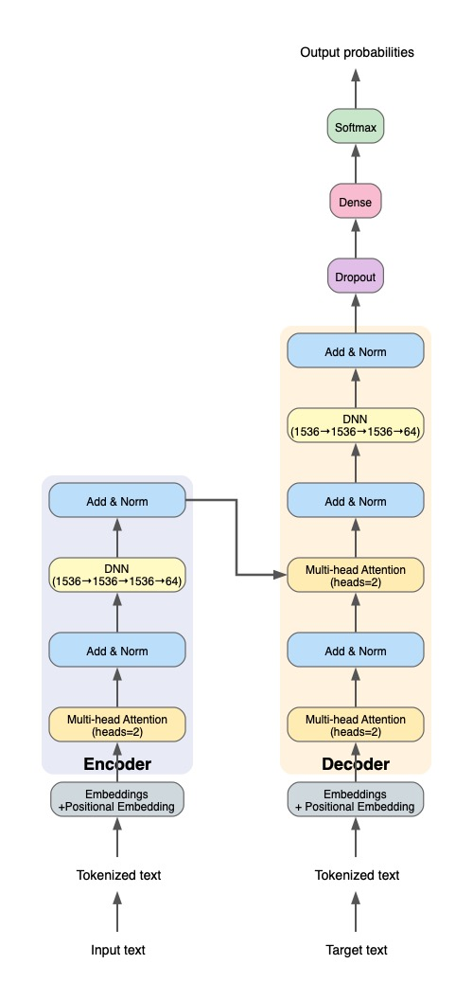
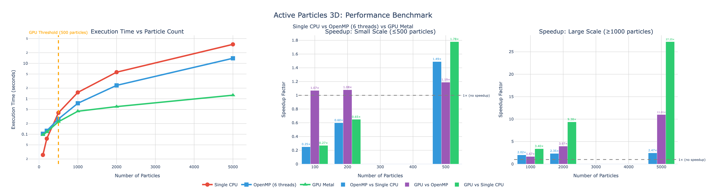

# Projects

## Featured Projects

### Scientific Literature RAG System
**AI-powered introduction generator for scientific papers**

*Live demonstration of the Scientific Literature RAG system generating introductions with semantic search and citation extraction.*

A production-ready RAG system that automatically generates well-structured, literature-informed introductions for scientific papers. The system indexes research papers and leverages LLMs to synthesize relevant literature into comprehensive introductions with properly formatted citations.

**Key Features:**
- **Multi-Provider LLM Support**: Claude (Anthropic), OpenAI GPT-4/GPT-4o, Google Gemini
- **SPECTER2 Embeddings**: Domain-optimized scientific embeddings for superior semantic understanding
- **GPU Acceleration**: Metal GPU support for Apple Silicon, CUDA for NVIDIA, automatic CPU fallback
- **Smart PDF Processing**: Semantic chunking (500-word chunks with 50-word overlap)
- **ChromaDB Vector Search**: Persistent local storage with cosine similarity search
- **Automatic BibTeX Citations**: Extracts and formats references with sophisticated metadata extraction
- **Interactive Dash UI**: User-friendly web interface for literature exploration
- **ROUGE Evaluation**: Built-in evaluation metrics for assessing generation quality (F1 scores >0.5)

**Performance:**
- Embedding: 50-100 chunks/second on Apple Silicon
- Generation: 10-30 seconds per introduction
- Indexing: ~1 minute per 100 PDFs

**Technologies:** Python 3.11+, GPU, LLM, ChromaDB, SPECTER2, RAG, Dash  
**Status:** Production Ready | Apache 2.0 License  
[→ View on GitHub](https://github.com/jvachier/scientific-literature-rag)

---

### Speech-to-Text with Sentiment Analysis and Translation
**Real-time multilingual processing pipeline**

*Detailed architecture of the Transformer model showing encoder-decoder structure with multi-head attention mechanisms.*

A comprehensive end-to-end system integrating speech recognition, sentiment analysis, and neural machine translation. Built with from-scratch Transformer implementation demonstrating deep understanding of attention mechanisms and encoder-decoder architectures.

**Key Features:**
- **Real-time Speech-to-Text**: Audio capture and transcription using Vosk library (English)
- **From-Scratch Transformer**: Complete encoder-decoder architecture without pre-trained models
- **Custom Multi-Head Attention**: Manually implemented attention mechanisms with configurable heads
- **Positional Encoding**: Hand-crafted sinusoidal position embeddings
- **Sentiment Classification**: Bidirectional LSTM with 95% test accuracy
- **Interactive Dash Web App**: Real-time processing with visual feedback and export functionality
- **Hyperparameter Optimization**: Automated tuning with Optuna for both models
- **BLEU Score Evaluation**: Translation quality metrics and model assessment

**Performance Metrics:**
- Sentiment Analysis (BiLSTM): 95.00% test accuracy
- Translation (Transformer): 67.26% test accuracy, 0.52 BLEU score
- Real-time processing with instant speech recognition and translation

**Architecture Highlights:**
- Educational implementation demonstrating core concepts
- Full control over attention mechanisms and positional encodings
- Research-grade code suitable for experimentation
- Clean, well-documented implementation

**Technologies:** Python 3.11+, Transformer, Bidirection LSTM, TensorFlow, Keras, Vosk, Dash, Optuna  
**Status:** Research/Educational | Apache 2.0 License  
[→ View on GitHub](https://github.com/jvachier/Sentiment_Analysis)  
[→ View Transformer Model on HuggingFace](https://huggingface.co/Jvachier/en-fr-transformer-from-scratch)  
[→ Try Interactive Demo on HuggingFace Spaces](https://huggingface.co/spaces/Jvachier/transformer-nmt-en-fr)  
[→ View on Kaggle](https://www.kaggle.com/code/jvachier/transformer-nmt-en-fr)

---

### Active Particles in 3D Confinement
**GPU-accelerated molecular dynamics simulation**

*Performance comparison across CPU and GPU implementations showing up to 27× speedup on Apple Silicon.*

*Simulation of 1000 active Brownian particles under 3D cylindrical confinement, demonstrating collective motion and particle-particle interactions with Lennard-Jones repulsion.*

A high-performance C++ simulation framework for modeling active Brownian particles (ABPs) under cylindrical confinement in 3D space. Implements Euler-Maruyama algorithm for Langevin dynamics with dual CPU/GPU implementations.

**Key Features:**
- **Dual Implementations**: CPU-only (OpenMP) and GPU hybrid (Metal) versions
- **GPU Acceleration**: Up to 27× speedup on Apple Silicon for large systems (N ≥ 1000)
- **Langevin Dynamics**: Proper stochastic noise generation with Euler-Maruyama integration
- **3D Cylindrical Confinement**: Reflective boundary conditions for realistic physical constraints
- **Lennard-Jones Interactions**: Repulsive particle-particle forces with configurable strength
- **OpenMP Parallelization**: Multi-threaded CPU optimization for all particle counts
- **Automatic CPU/GPU Selection**: Smart threshold-based switching for optimal performance
- **Numerical Stability**: Robust safeguards prevent NaN overflow at high particle densities

**Performance Benchmarks (Apple M2, 1000 timesteps):**

| Particles | CPU (1 thread) | CPU (OpenMP 6) | GPU (Metal) | GPU vs 1 CPU | GPU vs OpenMP |
|-----------|----------------|----------------|-------------|--------------|---------------|
| 100       | 0.026s         | 0.103s         | 0.096s      | 0.3×         | 0.9×          |
| 200       | 0.075s         | 0.125s         | 0.115s      | 0.7×         | 1.1×          |
| 500       | 0.401s         | 0.269s         | 0.225s      | **1.8×**     | **1.2×**      |
| 1,000     | 1.514s         | 0.747s         | 0.445s      | **3.4×**     | **1.7×**      |
| 2,000     | 5.638s         | 2.389s         | 0.601s      | **9.4×**     | **4.0×**      |
| 5,000     | 34.393s        | 13.903s        | 1.262s      | **27.3×**    | **11.0×**     |

**Physical Model:**
- Active Brownian particles with self-propulsion
- Translational and rotational diffusion
- Repulsive Lennard-Jones potential
- Applications: bacterial suspensions, cell motility, colloidal systems

**Technologies:** C++17, OpenMP, Metal GPU 
**Status:** Research-Grade | Apache 2.0 License  
[→ View on GitHub](https://github.com/jvachier/active_particles_in_3D)

---

### Personality Classification with Ensemble Learning
**Production ML pipeline achieving Kaggle top 5%**

*Interactive dashboard for real-time personality classification with model explainability and performance metrics.*

A production-ready machine learning pipeline for personality classification using ensemble learning, achieving **top 5% (200/4,329)** in the [Kaggle Personality Classification Competition](https://www.kaggle.com/competitions/playground-series-s5e7). Features modular architecture, automated hyperparameter optimization, and interactive visualization.

**Key Features:**
- **Six Ensemble Stacks**: Complementary ML algorithms (Random Forest, XGBoost, LightGBM, CatBoost, Neural Networks)
- **Advanced Data Augmentation**: SDV Copula-based synthetic data generation with quality control
- **Automated Hyperparameter Optimization**: Optuna-powered tuning for each stack (200+ trials for blending)
- **Interactive Dash Dashboard**: Real-time predictions, model explainability, and performance visualization
- **Meta-Learning Approach**: Logistic Regression ensemble combiner with optimized blending weights
- **Out-of-Fold Predictions**: Unbiased ensemble training with stratified cross-validation
- **Production-Ready**: Full test coverage, CI/CD pipeline, comprehensive logging

**Ensemble Architecture:**

| Stack | Focus | Algorithms | Special Features |
|-------|-------|-----------|------------------|
| A | Traditional ML (Narrow) | RF, LR, XGBoost, LightGBM, CatBoost | Stable baseline |
| B | Traditional ML (Wide) | Same as A | Extended search space |
| C | Gradient Boosting | XGBoost, CatBoost | Tree specialists |
| D | Sklearn Ensemble | Extra Trees, Hist GB, SVM, Gaussian NB | Diverse mix |
| E | Neural Networks | MLPClassifier, Deep architectures | Non-linear patterns |
| F | Noise-Robust | Same as A + label noise | Improved generalization |

**Competition Results:**
- **Rank**: 200/4,329 (Top 5%)
- **Dataset**: ~18,000+ training samples (with augmentation), 8 personality dimensions
- **Cross-Validation**: Stratified 5-fold CV for robust evaluation

**Technologies:** Python 3.11+, scikit-learn, XGBoost, LightGBM, CatBoost, Optuna, Dash, Plotly
**Status**: Production Ready | Apache 2.0 License  
[→ View on GitHub](https://github.com/jvachier/Personality-classification)

---

### Industrial Audio Anomaly Detection
**Unsupervised anomaly detection for industrial machine audio**

*Upload a .wav recording to the Gradio app and get a verdict (normal/anomalous), the pooled Mahalanobis anomaly score, and its percentile against the calibration distribution of normal clips.*

*Per-machine-ID mean AUC-ROC for all detector families across fan, pump, and valve, averaged over 3 seeds with ±1 std error bars. The embedding model dominates on valve and fan; the Dense AE leads on pump.*

*ROC curves on valve comparing oracle per-ID scoring against ArcFace pooled Mahalanobis scoring. The curves overlap: the deployment constraint of knowing the machine ID is removed without meaningful loss in detection performance.*

Unsupervised anomaly detection on industrial machine audio, benchmarked on the MIMII pump dataset and DCASE 2020 Task 2 (fan, pump, valve at 0 dB SNR). Three detector families are compared in increasing order of sophistication: a Dense Autoencoder, a Transformer-VAE scored by ELBO and KL divergence, and an ArcFace-trained embedding model scored by Mahalanobis distance to the stationary distribution of normal embeddings. The deployed valve model requires no known machine ID at inference and reaches 0.947 AUC.

**Key Features:**
- **Three Detector Families**: Dense Autoencoder, Transformer-VAE (ELBO and KL scoring), and ArcFace embedding + Mahalanobis distance
- **From-Scratch DSP**: STFT, triangular mel filterbank, and patch extraction implemented in NumPy/SciPy, no librosa
- **ArcFace Angular Margin Loss**: Tightens per-machine-ID clusters on the hypersphere for reliable scoring without a known machine ID
- **Pooled Mahalanobis Deployment Scoring**: Single LedoitWolf distribution fitted across all machine IDs, no oracle ID required at inference
- **Gradio Web App**: Upload a .wav recording and get a verdict, anomaly score, and percentile against the calibration distribution
- **HuggingFace Hub Integration**: Models downloaded and cached automatically on first run
- **CLI + Python API**: `iaad score`, `iaad ensemble`, `iaad evaluate` commands, plus `AnomalyDetector` / `EnsembleDetector` classes
- **Full Test Coverage + CI**: pytest suite, Ruff linting, pre-commit hooks, GitHub Actions CI

**Results (per-machine-ID mean AUC-ROC, chance = 0.500):**

| Detector | Fan | Pump | Valve |
|---|:---:|:---:|:---:|
| Dense AE | 0.501 | **0.671** | 0.632 |
| Transformer-VAE (recon) | 0.501 | 0.667 | 0.591 |
| Transformer-VAE (KL) | 0.491 | 0.631 | 0.439 |
| EMB per-ID (oracle) | **0.714** | 0.645 | 0.966 |
| **EMB pooled Mahalanobis (deployed)** | 0.730 | 0.738 | **0.947** |

**Datasets:**
- MIMII pump (Purohit et al., 2019): single machine type, ~380 normal and 136 anomalous clips at 16 kHz
- DCASE 2020 Task 2 (Koizumi et al., 2020): fan, pump, and valve at 0 dB SNR, 4 physical machine units per type

**Technologies:** Python 3.11+, TensorFlow, Keras, Transformer, ArcFace, Gradio, HuggingFace Hub  
**Status:** Production Ready | Apache 2.0 License  
[→ View on GitHub](https://github.com/jvachier/industrial-audio-anomaly-detection)  
[→ Read the Blog Post](https://jvachier.github.io/blog/2026/06/25/the-same-encoder-a-different-distance/)  
[→ View Model on HuggingFace](https://huggingface.co/jvachier/dcase2020-task2-anomaly-detection)  
[→ View on Kaggle: MIMII Pump Baseline](https://www.kaggle.com/code/jvachier/unsupervised-industrial-audio-anomaly-detection)  
[→ View on Kaggle: DCASE 2020 Benchmark](https://www.kaggle.com/code/jvachier/unsupervised-audio-anomaly-ae-vae-transformer)

---

### Meeting Notes from Raw Transcripts
**Two from-scratch transformers that turn a raw meeting transcript into notes**

*The Dash app: Model 2 restores punctuation and casing in a voice note, then Model 1 turns a raw speech-to-text transcript into decisions, action items (with owners) and key points, with the importance score of every sentence.*

*From a raw transcript to meeting notes: punctuation restoration (Model 2), sentence splitting, sentence scoring (Model 1) and fixed selection rules.*

Two small transformer models built entirely from scratch with Keras 3 on the JAX backend: own WordPiece tokenizer, own architectures, no pretrained weights. **Model 2** (7.3M parameters) restores punctuation and casing in lowercase speech-to-text output. **Model 1** (20.9M parameters) reads a whole meeting and picks the sentences that matter, sorting them into decisions, action items with owner and deadline, and key points. Model 1 is trained on a gold-labelled meeting corpus I built for this project, with real AMI meetings as the headline test set. Both models are published on Hugging Face.

*Model 1 is hierarchical: a sentence encoder (pretrained by masked-language modelling) reads each sentence on its own, then a meeting encoder lets the sentences attend to each other before the per-sentence heads.*

**Key Features:**
- **From Scratch**: WordPiece tokenizer, pre-LayerNorm transformers and custom Keras layers, no pretrained weights or tokenizers
- **Hierarchical Meeting Model**: Sentence encoder + meeting encoder over up to 256 sentences per window, with speaker and speaker-change embeddings
- **Gold-Labelled Corpus**: [meeting-notes-extractive-v1](https://huggingface.co/datasets/Jvachier/meeting-notes-extractive-v1), about 1,900 meetings and 260,000 labelled sentences (hand-written synthetic meetings with hard negatives, plus real AMI meetings)
- **Teacher Distillation Experiment**: Qwen3-0.6B (reasoning labels) and a fine-tuned RoBERTa-Large as teachers, compared with gold-only training
- **Owners, Deadlines and Replies**: Span head for owner / deadline, and rules that attach short replies ("OK, I will email him tonight.") to the request they answer
- **Interactive Dash App**: Punctuation restoration and meeting notes side by side, with an importance chart, served by gunicorn in Docker
- **Self-Contained Releases**: Each Hugging Face repo ships its own `modeling.py`, so the models run with only `keras`, `jax` and `tokenizers`
- **Production Practices**: Every hyperparameter in versioned configs, 3 seeds per run, model selection on validation only, full test suite, pre-commit and GitHub Actions CI

**Results (Model 1, test set, importance F1, mean ± std over 3 seeds):**

| System | Params | Pretrained | AMI (real meetings) | Synthetic meetings |
|---|:---:|:---:|:---:|:---:|
| Lead-k (first sentences) | – | – | 0.319 | 0.337 |
| Qwen3-0.6B (prompted) | 600M | yes | 0.318 | 0.403 |
| DistilBERT (fine-tuned) | 66M | yes | 0.580 | 0.870 |
| RoBERTa-Large (fine-tuned) | 355M | yes | **0.634** | **0.903** |
| Ours + distillation (E4) | 20.9M | no | 0.567 ± 0.006 | 0.884 ± 0.006 |
| **Ours, gold labels only (released)** | **20.9M** | **no** | 0.578 ± 0.006 | 0.878 ± 0.013 |

**Key Findings:**
- From scratch and with a third of the parameters, Model 1 **matches a fine-tuned DistilBERT** on real meetings, 5.6 points below RoBERTa-Large (17× larger)
- **Distillation did not help**: training with the Qwen and RoBERTa teachers was slightly worse than gold labels alone, so the released model uses no teacher
- Model 2 reaches **0.789 punctuation macro-F1 and 0.965 casing accuracy** on DialogSum (rule baseline: 0.093), and stays at 0.662 with 20% of the words corrupted
- Limits, stated plainly: the notes are extractive (a decision spread over several turns is not written out), and decision / action-item F1 on real AMI meetings stays below 0.1 for every system tested

**Technologies:** Python 3.11+, Keras 3, JAX, Transformer (from scratch), WordPiece tokenizer, Dash, Docker, Hugging Face Hub  
**Status:** Production Ready | Code: MIT License · Models: CC BY-NC-SA 4.0  
[→ View on GitHub](https://github.com/jvachier/Note_taker)  
[→ View Meeting Notes Model on HuggingFace](https://huggingface.co/Jvachier/meeting-notes-en-21m)  
[→ View Punctuation & Casing Model on HuggingFace](https://huggingface.co/Jvachier/punctuation-casing-en-7m)  
[→ View Dataset on HuggingFace](https://huggingface.co/datasets/Jvachier/meeting-notes-extractive-v1)  
[→ View Dataset on Kaggle](https://www.kaggle.com/datasets/jvachier/meeting-notes-extractive-v1)

---

## Open Source Contributions

All public projects available on [GitHub](https://github.com/jvachier)
